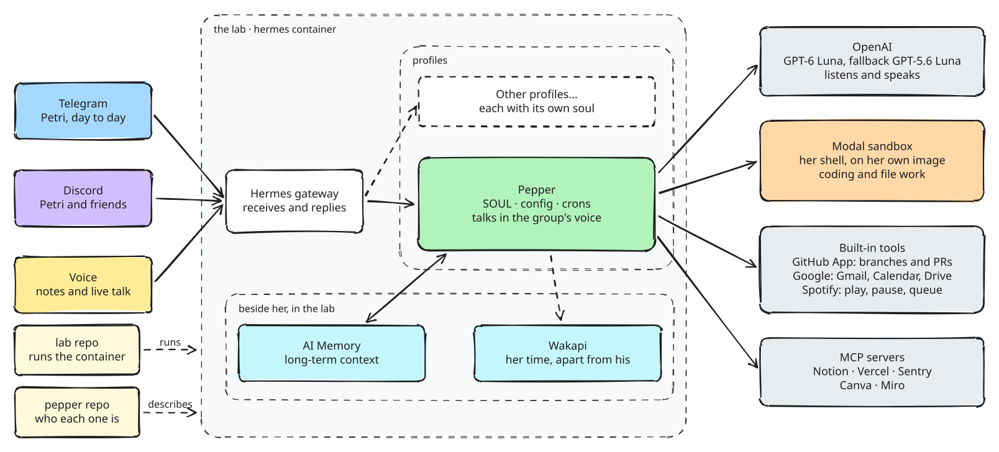
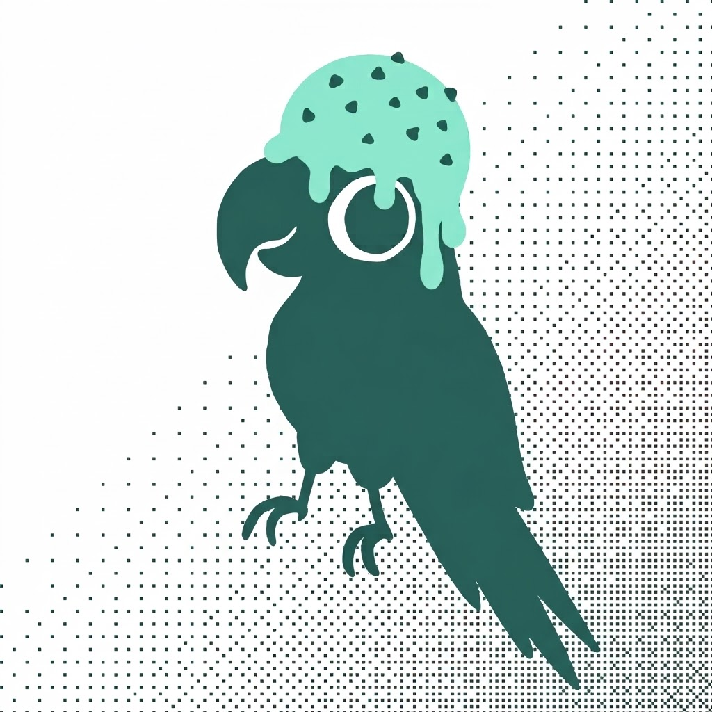

<h1 align="center">🐦 pepper</h1>

<br>

<h3 align="center">The workstation for the Hermes agents in my lab.<br>What each one is, what it's wired to, and why</h3>

<p align="center">
  
</p>

<br>

## About

> **TL;DR:** Pepper is the agent that runs in my [lab](https://github.com/Petri-Hub/lab): she sets reminders and crons, notifies me on Telegram and Discord, opens PRs on my repos, and reaches my Gmail, Calendar and Drive. The lab runs her container. This repo keeps what runs inside it, the personality, the model and every platform she's wired to, written so I can tell what's configured without opening a YAML file.

## How it works

<p align="center">
  
</p>

Messages from Telegram, Discord and voice reach Pepper through the Hermes gateway. She uses OpenAI, her own tools and MCP connections, with a Modal sandbox for shell work and AI Memory for long-term context. The lab runs the container; this repository describes the agents.

## Profiles

| Avatar | Profile | What it is | Model | Talks on |
|:---:|---|---|---|---|
|  | [Pepper](profiles/pepper/CONFIG.md) | My general-purpose assistant: reminders, crons, GitHub, research, errands | OpenAI | Telegram · Discord · voice |
|  | [Mint](profiles/mint/CONFIG.md) | Bárbara's personal assistant for everyday help and design work | OpenAI | Telegram · Discord · voice |
|  | [Lemon](profiles/lemon/CONFIG.md) | Discord collaborator for a Roblox game, with his own development workspace | DeepSeek | Discord |

## Philosophy

**Decisions, not files.**  
Hermes fills most of an agent's configuration with its own defaults. What's worth keeping is what I actually chose, so everything else stays out. The less configuration it takes to get the same agent, the better.

**Intent over implementation.**  
When I ask for voice transcription in Portuguese, what matters is the provider and the model. The small adjustments made along the way are details, and they only get recorded when they were the point.

**Readable before reproducible.**  
Anyone should be able to open a profile and understand who the agent is, where it talks and why, without knowing Hermes. The configuration comes after the explanation, never instead of it.

**Every change has a story.**  
Each profile keeps a changelog written in the words I used to ask for it, so months later I still know why something is there, and not only that it is.

**The lab owns the body, this repo owns the mind.**  
The container, the ports and the secrets belong to the lab. Here lives who each agent is: the personality, the model, the platforms and how it behaves.

**What moves fast stays out.**  
Hermes manages day-to-day skills, memories and reminders. Selected shared skills live here when this repository is their maintained source; applying them replaces the agent's copies.

**No committed credentials.**
Tracked files hold placeholders only. Local, gitignored profile `.env` files hold values for manual setup; the live values are in the lab.

## What's inside

```sh
├── .claude/rules      # how agents write profiles and .env files here
├── .github/workflows  # publishes agent images and refreshes the Wakapi cards below
├── assets             # the diagram, as an editable Excalidraw file and its SVG
├── profiles
│   └── <name>
│       ├── .env           # optional local credentials; gitignored
│       ├── .env.example   # the variables the agent needs, with placeholders
│       ├── avatar.png     # its picture on every platform
│       ├── CHANGELOG.md   # every change, in the words I asked for it
│       ├── CONFIG.md      # what's configured, and why, with the settings that do it
│       ├── SOUL.md        # who the agent is, and the rules it follows
│       ├── sandbox        # optional image for the agent's terminal
│       ├── skills         # optional repository-managed shared skills
│       └── sync-skills.sh # optional skill deployment helper
└── AGENTS.md          # the conventions for working in this repository
```

## Technologies

| &nbsp;&nbsp;&nbsp;&nbsp;&nbsp; | Technology | Used for |
|:---:|---|---|
|  | [Hermes](https://hermes-agent.nousresearch.com/docs/) | The agent framework from Nous Research that every profile runs on, with memory, skills, crons and messaging built in |
|  | [OpenAI](https://platform.openai.com/docs) | The model Pepper thinks with, and the voice she listens and speaks with |
|  | [Telegram](https://core.telegram.org/bots) | Where I talk to Pepper day to day, and where her reminders reach me |
|  | [Discord](https://discord.com/developers/docs) | Where Pepper hangs out with my friends, and where they can ask her things too |
|  | [GitHub](https://docs.github.com/en/apps) | Where Pepper works on my repositories through her own GitHub App, always through pull requests |
|  | [Google Workspace](https://developers.google.com/workspace) | Gmail, Calendar and Drive, reached with an OAuth client of mine that Pepper holds her own token for |
|  | [Notion](https://developers.notion.com/docs/mcp) | My pages and databases, reached over Notion's hosted MCP server as her first MCP connection |
|  | [Vercel](https://vercel.com/docs/mcp) | My deployments, logs and projects, over Vercel's hosted MCP server |
|  | [Sentry](https://docs.sentry.io/product/sentry-mcp/) | Issues and stack traces from my projects, over Sentry's hosted MCP server |
|  | [Canva](https://www.canva.dev/docs/mcp/) | My designs, folders and brand templates, over Canva's hosted MCP server |
|  | [Miro](https://developers.miro.com/docs/connecting-to-miro-mcp) | My boards and spaces, reached over Miro's hosted MCP server |
|  | [FAM MCP](https://github.com/Petri-Hub/fam-mcp) | My grades, assignments, schedule and other university portal data, through my read-only MCP server published on PyPI |
|  | [Modal](https://modal.com/docs) | The cloud sandbox her shell commands run in, so nothing she executes touches the lab host |
|  | [Docker](https://docs.docker.com/) | The container in the lab that Pepper lives in |

## Time tracking

Each agent reports to a separate Wakapi user in the lab. These cards show Wakapi's counted time over the last 30 days, refreshed nightly and kept out of my own stats. The current Wakapi version excludes AI app heartbeats from duration totals, so conversations and crons can be recorded without adding time here.

### 🐦 Pepper

<!--START_SECTION:pepper-->

```rust
Total Time: 1 hrs 19 mins

Unknown    1 hrs 5 mins    ████████████████████▓░░░░   82.30 %
Python     0 hrs 7 mins    ██▒░░░░░░░░░░░░░░░░░░░░░░   08.89 %
Markdown   0 hrs 7 mins    ██▒░░░░░░░░░░░░░░░░░░░░░░   08.81 %
```

<!--END_SECTION:pepper-->

### 🌿 Mint

<!--START_SECTION:mint-->

```rust
Total Time: 0 hrs 3 mins

Unknown   0 hrs 3 mins    █████████████████████████   100.00 %
Python    0 hrs 0 mins    ░░░░░░░░░░░░░░░░░░░░░░░░░   00.00 %
```

<!--END_SECTION:mint-->

### 🍋 Lemon

<!--START_SECTION:lemon-->

```rust
Total Time: 0 hrs 0 mins

No activity tracked
```

<!--END_SECTION:lemon-->

## Roadmap

### 🐦 Pepper

#### Done

- ✅ Hermes in the lab, using OpenAI with a fallback for provider errors
- ✅ Telegram and Discord chats, voice notes and live conversations
- ✅ Her GitHub App opens pull requests under her own identity
- ✅ Gmail, Calendar and Drive through Google OAuth in production
- ✅ Notion, Vercel and Sentry over MCP for pages, deployments and issues
- ✅ Canva and Miro over MCP for designs, boards and templates
- ✅ Read-only FAM MCP and website skills for inbox and assignments
- ✅ Crons and reminders delivered through Telegram or Discord
- ✅ A Modal sandbox with her own image, tools and Python libraries
- ✅ GitHub and Google access inside the sandbox when she needs them
- ✅ Sandbox files delivered to chat and retained after rebuilds
- ✅ AI Memory for long-term context across her conversations
- ✅ Skills and skill management available in chat and scheduled work
- ✅ Hermes session search disabled across her profile
- ✅ Her own Wakapi account for agent heartbeats and coding activity
- ✅ Backups of her soul, settings, skills, crons and memories
- ✅ Spotify playback, pause and queue control from chat
- ✅ Excalidraw, pixel art, animated PR diagrams and Hyperframes video
- ✅ Morning report covering her health, calendar, mail and GitHub
- ✅ *marin* for spoken replies and GPT-Live conversations
- ✅ Casual Portuguese SOUL with clear trust and privacy boundaries

### 🌿 Mint

#### Done

- ✅ Separate Hermes profile with his own OpenAI key and fallback model
- ✅ Telegram and Discord bots, with Cedar for voice notes and live chat
- ✅ His own Modal workspace and sandbox for shell commands
- ✅ Medium reasoning, a 500-turn cap and São Paulo time
- ✅ Notes and reminders stored separately from Pepper's profile
- ✅ Skills and skill management available in chat and scheduled work
- ✅ Hermes session search disabled across his profile
- ✅ Reasoning, tool progress and busy/steering notices hidden in chat
- ✅ Cron replies without wrappers, long-run updates or restart notices
- ✅ Full Restic backup of his live profile, with a file restore tested
- ✅ A five-minute Wakapi reporter and a nightly README card
- ✅ A subtler butler voice with direct answers and fewer stock closers
- ✅ Vercel MCP for her apps and deployments, authorized in Mint's own profile
- ✅ Notion MCP for Bárbara's pages, authorized with her own account
- ✅ A public Modal sandbox image with Google's Python libraries
- ✅ Gmail, Calendar and Drive through Bárbara's separate Google OAuth grant
- ✅ His own GitHub App, acting on Bárbara's repositories under the bot's name

### 🍋 Lemon

#### Done

- ✅ Prepare DeepSeek and Discord environment placeholders.
- ✅ Create a Hermes profile with DeepSeek Flash and general tools.
- ✅ Connect Lemon's Discord bot with an 18-person allowlist.
- ✅ Verify Lemon replies in the Discord server.
- ✅ Configure voice transcription and spoken replies in chat.
- ✅ Run Lemon's separate Wakapi activity reporter.
- ✅ Connect Roblox Assets MCP for Creator Store assets through Lemon's SSH sandbox.
- ✅ Give Lemon asset uploads and lifecycle management through Roblox Assets MCP.
- ✅ Build Lemon's reusable image with Git, Make, Rokit and SSH.
- ✅ Publish Lemon's development image to GHCR on merge.
- ✅ Run his image as a persistent container in the lab.
- ✅ Connect his terminal to that container over SSH.
- ✅ Skills and skill management available in Discord.
- ✅ Curate his skill index for game development and creative work.
- ✅ Define his Roblox SOUL and collaboration skills.
- ✅ Add a game design skill for critique and player experience.
- ✅ Give Lemon modelling and texture workflows for Roblox assets.
- ✅ Record feedback about Lemon as GitHub issues in Pepper.
- ✅ Render Blender previews with a short-lived Modal GPU and a dedicated image.
- ✅ Disable built-in memory and user profile while his role takes shape.
- ✅ Code execution available in Discord.
- ✅ Hermes session search disabled across his profile.
- ✅ Keep the game's repository in his workspace.
- ✅ Create Lemon's GitHub App for branches and pull requests.
- ✅ Langfuse Cloud tracing with Lemon's own Ingestion key and raw content capture.
- ✅ Low reasoning, a 150,000-token working window with compression at 85%, a 500-turn cap and São Paulo time.
- ✅ Context-window percentage shown in final reply footers.
- ✅ Verbose tool progress available in Discord.
- ✅ Cron replies without Hermes wrappers.
- ✅ Gateway shutdown and restart notices left on.
- ✅ Home channel set to Pepper's Discord channel.
- ✅ Show rough drafts in stages so the group can steer early.
- ✅ Merge only after the group says a change is finished.
- ✅ Hermes completion guidance and background skill reviews off.
- ✅ A 15-minute run budget that asks him to wrap up.
- ✅ Scaffold new games as local Git repositories with `/create`.
- ✅ Retire roblox-with-swe from his work and keep it as a reference.

#### Open

- ⬜ Evaluate and test his use of Discord's supported Markdown formatting.
- ⬜ Evaluate public Creator Store listing management through his MCP tools.
- ⬜ Create a planning skill that writes and attaches a Markdown file in chat.

## References

- [Hermes Agent](https://hermes-agent.nousresearch.com/docs/): the documentation for the framework every profile runs on
- [Hermes Agent on GitHub](https://github.com/NousResearch/hermes-agent): the source code, from [Nous Research](https://nousresearch.com)
- [Hermes Langfuse plugin](https://hermes-agent.nousresearch.com/docs/plugins/langfuse): Lemon's tracing integration and its catalog successor
- [OpenAI API Platform](https://platform.openai.com/docs): the models behind Pepper's thinking, transcription and voice
- [Telegram Bot API](https://core.telegram.org/bots/api): how Pepper's Telegram bot talks to Telegram
- [Discord Developer Portal](https://discord.com/developers/applications): where Pepper's Discord bot is registered
- [GitHub Apps](https://docs.github.com/en/apps): how Pepper gets her own identity on GitHub
- [Google Workspace skill](https://hermes-agent.nousresearch.com/docs/user-guide/skills/bundled/productivity/productivity-google-workspace): the bundled Hermes skill that gives Pepper Gmail, Calendar and Drive
- [Notion MCP](https://developers.notion.com/docs/mcp): the hosted server Pepper and Mint reach Notion through
- [Vercel MCP](https://vercel.com/docs/mcp): the hosted server Pepper reaches Vercel through
- [Sentry MCP](https://docs.sentry.io/product/sentry-mcp/): the hosted server Pepper reaches Sentry through
- [Canva MCP](https://www.canva.dev/docs/mcp/): the hosted server Pepper reaches Canva through
- [Miro MCP](https://developers.miro.com/docs/connecting-to-miro-mcp): the hosted server Pepper reaches Miro through
- [FAM MCP](https://pypi.org/project/fam-mcp/): the read-only server Pepper reaches the university portal through
- [MCP in Hermes](https://hermes-agent.nousresearch.com/docs/user-guide/features/mcp): how Pepper's MCP servers are configured and authorized
- [Modal](https://modal.com/docs): the cloud sandbox Hermes sends her terminal commands to
- [Docker](https://docs.docker.com/): what runs Pepper's container in the lab
- [lab](https://github.com/Petri-Hub/lab): the homelab that hosts her
- [Wakapi](https://wakapi.dev): the self-hosted time tracker where each agent reports activity
- [waka-readme](https://github.com/athul/waka-readme): the action that updates the three time tracking sections from Wakapi's stats
- [ai-memory](https://github.com/akitaonrails/ai-memory): long-term context for Pepper through the [community Hermes plugin](https://github.com/MrLuciano/ai-memory-hermes-plugin)
- [roblox-with-swe](https://github.com/Petri-Hub/roblox-with-swe): the game Lemon helps build
- [Roblox Assets MCP](https://github.com/Petri-Hub/roblox-assets-mcp): Creator Store search and asset delivery
